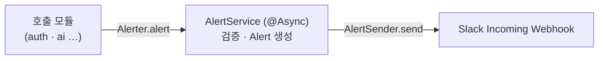

# 개발자 알림 (alert 모듈)

alert 모듈은 신규 가입·영상 업로드 같은 운영 이벤트를 개발자 Slack 채널로 보냅니다.
앱 사용자에게 가는 푸시 알림(`notification` 모듈)과 구분하려고 alert 용어를 씁니다.
어떤 이벤트를 알릴지는 호출하는 모듈이 정하고, alert 모듈은 제목·필드만 받아 전송합니다.



## 호출 방법

다른 모듈은 `application/provided`의 `Alerter`를 주입받아 `AlertRequest`를 넘깁니다. 필드(`AlertField`)는 `domain/shared`로 노출되어 있습니다.

```java
alerter.alert(AlertRequest.of("신규 가입",
		AlertField.of("userId", userId), AlertField.of("provider", provider)));
```

| 항목 | 제약 |
|---|---|
| `title` | 비어 있지 않은 150자 이하. Slack header 블록 한도와 같은 값 |
| `fields` | 20개 이하. 이름은 50자 이하, 값은 `AlertField.of`가 `Objects.toString`으로 바꾸며 null은 `-` |

- `Alerter.alert`는 바로 돌아옵니다. 검증과 전송은 비동기 스레드에서 수행되어 Slack 장애·지연은 호출 모듈의 흐름에 영향을 주지 않습니다.
- 검증 위반은 호출자에게 예외로 돌아오지 않고 전송 실패와 같은 경로(error 로그 → Sentry)로 보고됩니다. 제목·필드는 호출 코드의 상수라 위반은 버그이며, Sentry에서 `ConstraintViolationException`으로 보입니다.
- 필드 값에 이메일·전화번호 같은 개인정보를 넣지 않습니다. 회원은 ID로만 적습니다.

## 메시지 형식

모든 모듈이 같은 Block Kit 구조로 보냅니다. `text`는 푸시 알림·검색용 fallback입니다.

```json
{
  "text": "영상 분석 실패",
  "blocks": [
    {"type": "header", "text": {"type": "plain_text", "text": "영상 분석 실패"}},
    {"type": "section", "fields": [
      {"type": "mrkdwn", "text": "*userId*\n42"},
      {"type": "mrkdwn", "text": "*reason*\nGemini 응답 시간 초과"}
    ]},
    {"type": "context", "elements": [{"type": "mrkdwn", "text": "prod · 2026-11-02 21:34:56 KST"}]}
  ]
}
```

- section 블록은 필드 10개까지만 담을 수 있어 11개부터는 블록을 나눕니다. 필드가 없으면 section 블록을 만들지 않습니다.
- 필드 값이 500자를 넘으면 끝을 `…`로 잘라 보냅니다.
- context의 환경 이름은 활성 프로파일(`dev`·`prod`)이고, 시각은 서울 기준입니다.

## 설정

| 키 | 환경 변수 | 설명 |
|---|---|---|
| `meongcoach.alert.slack.enabled` | 없음(프로파일 yml) | `false`면 Slack 대신 `LogAlertSender`가 info 로그만 남깁니다. `local`·`test`는 `false` |
| `meongcoach.alert.slack.graduation-webhook-url` | `ALERT_SLACK_GRADUATION_WEBHOOK_URL` | 실습 인증 알림 채널의 Incoming Webhook URL. 기본값이 없어 `dev`·`prod`는 미주입 시 기동에 실패합니다 |

- 배포 값은 GitHub Secrets `ALERT_SLACK_GRADUATION_WEBHOOK_URL` 하나에 두고 `dev`·`prod`가 같은 채널로 보냅니다. 메시지는 context의 환경 이름으로 구분합니다. 시크릿이 없으면 CD의 task definition 렌더링이 실패합니다.
- 배포 CI가 쓰는 `SLACK_WEBHOOK_URL`과는 다른 값입니다.
- 로컬에서 실제 채널로 확인하려면 `application-local.yml`의 `enabled`를 `true`로 바꾸고 `ALERT_SLACK_GRADUATION_WEBHOOK_URL`에 webhook을 넣습니다. 메시지가 `dev`·`prod`와 같은 채널에 `local`로 올라갑니다. 확인 후 되돌립니다.

## 실패 처리

- `SlackAlertSender`는 Slack 응답 오류와 연결 실패를 `AlertDeliveryFailedException`으로 번역합니다. 예외에 cause를 담지 않습니다. `RestClient` 예외 메시지에 요청 URL이 들어가 webhook URL이 로그와 Sentry에 남기 때문입니다. detail은 `status=404`·`reason=ResourceAccessException`처럼 원인 종류만 적습니다.
- 비동기 메서드의 예외는 아무도 catch하지 않습니다. Spring의 `SimpleAsyncUncaughtExceptionHandler`가 error 로그를 남기고, logback 연동으로 Sentry에 보고됩니다.

## 비동기 실행

`AlertService` 하나에 `@Validated`와 `@Async`를 함께 둡니다. `AsyncAnnotationBeanPostProcessor`가 어드바이저를 체인 맨 앞에 넣어 `@Async`가 항상 바깥이 되므로, 검증도 비동기 스레드에서 실행됩니다. 검증 위반을 호출자에게 돌려주려면 검증 빈과 비동기 빈을 나눠야 하는데, 알림은 best-effort라 두 실패를 같은 경로로 두는 쪽을 택했습니다.

비동기 실행기는 Spring Boot가 자동 구성하는 `applicationTaskExecutor`입니다(`shared/config/AsyncConfig`의 `@EnableAsync`). `AlertService`에는 `@Transactional`을 붙이지 않습니다. DB를 쓰지 않을뿐더러, 비동기 스레드가 커넥션을 잡으면 테스트의 Hikari 풀(최대 2)이 바닥납니다.
