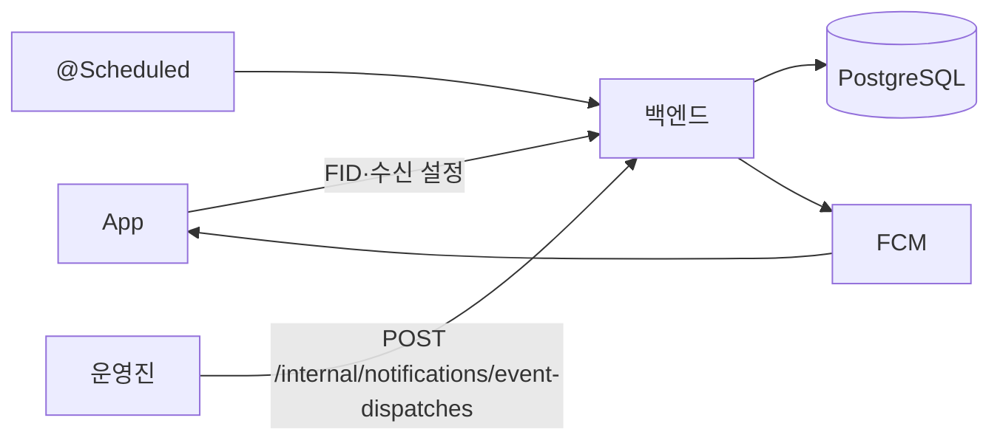
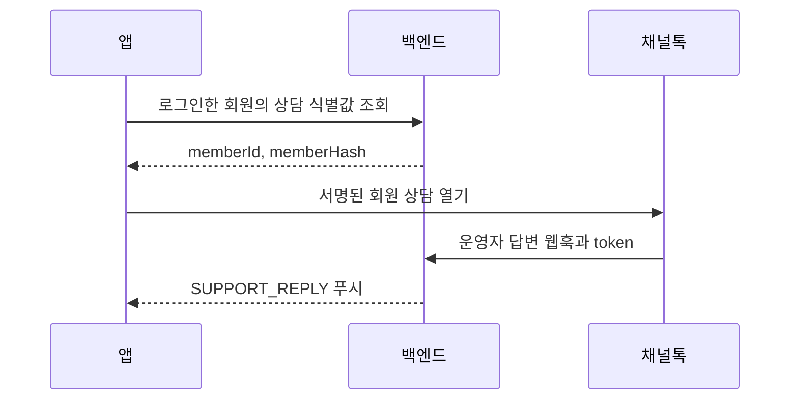

# 푸시 알림 (notification 모듈)

notification 모듈은 푸시 알림에 쓰는 회원의 기기 FID(Firebase Installation ID)와 수신 설정을 소유합니다.
백엔드는 발송 대상 조회, FCM 발송, 무효 FID 삭제를 맡습니다.



## 알림 구분

발송을 시작하는 주체로 나눕니다. 시계가 시작하면 스케줄 알림이고, 사건이 시작하면 이벤트 알림입니다.

| 항목 | 스케줄 알림 | 이벤트 알림 |
|---|---|---|
| 해당 알림 | 훈련 | AI 분석, 운영 알림, 댓글, 문의 답변 |
| 회원 설정 | `NotificationSchedule` | `NotificationEventSetting` |
| 발송 대상 | 그 시각을 켠 회원 | 지정한 회원 중 그 종류를 켠 회원 |
| 문구 | 서버가 정함 | 호출자가 정함 |
| 중복 방지 | 잠금과 완료 이력 | 없음 |
| 유스케이스 | `ScheduledNotificationDispatcher` | `EventNotificationDispatcher` |

`NotificationDispatchService`가 두 유스케이스를 구현하고 FID 조회, FCM 전송, 무효 FID 삭제를 공유합니다.
알림 이력 테이블과 발송 로그는 두지 않습니다.

## 애그리거트

| 애그리거트 | 범위 | 저장 내용 |
|---|---|---|
| `DeviceInstallation` | FID당 한 행 | 회원 ID, Firebase Installation ID(FID), 플랫폼(`IOS`·`ANDROID`), 마지막 확인 시각 |
| `NotificationSchedule` | 회원·시·분당 한 행 | 시(Asia/Seoul 기준 0~23), 분(0~59), 수신 여부 |
| `NotificationEventSetting` | 회원·종류당 한 행 | 종류(`AI_ANALYSIS`·`OPERATOR_MESSAGE`·`COMMENT`·`SUPPORT_REPLY`), 수신 여부 |
| `ScheduledNotificationDispatch` | 예약 시각당 한 행 | 완료한 예약 시각 |

- 회원은 ID로만 참조합니다. 다른 모듈의 엔티티를 연관으로 잡지 않습니다.
- FID는 전체에서 유니크입니다. 같은 FID가 다시 들어오면 회원 ID와 마지막 확인 시각을 덮어씁니다.
- 시각 범위는 DB `CHECK` 제약과 `NotificationTime`이 함께 지킵니다.
- 앱이 쓰는 시각은 8:00·11:00·17:00입니다. 기본값은 8:00·11:00 끔, 17:00 켬입니다. 허용 시각은 `NotificationTime` 상수에만 두고 DB 제약으로 묶지 않습니다.
- `NotificationEventSetting`은 회원이 어떤 종류의 이벤트 알림을 구독할지 나타냅니다. 이벤트 알림은 해당 종류를 켠 회원에게만 발송합니다.
- 이벤트 설정의 기본값은 모든 종류 켬입니다.
- FID를 처음 등록할 때 `NotificationSchedules`와 `NotificationEventSettings`가 없는 시각 설정과 이벤트 설정을 기본값으로 만듭니다. 새 종류를 추가하면 마이그레이션으로 기존 회원의 행을 채웁니다.
- 설정 행이 없는 회원은 발송 대상이 아닙니다. 조회는 빈 목록으로 응답하고 행을 만들지 않습니다.

## 앱 API (JWT 인증)

| 메서드·경로 | 동작 |
|---|---|
| `PUT /api/notifications/installations` | FID upsert. 없는 기본 설정 생성. 204 |
| `DELETE /api/notifications/installations` | 로그아웃 때 본인 FID 삭제. 본문 `{fid}`. FID를 URL에 두면 접근 로그에 남으므로 본문으로 받는다. 없는 FID여도 204 |
| `GET /api/notifications/schedules` | `{schedules: [{hour, minute, enabled}]}`. 시·분 오름차순 |
| `PUT /api/notifications/schedules` | 본문 `{hour, minute, enabled}`로 upsert. 204. 허용 시각이 아니면 400 |
| `GET /api/notifications/event-settings` | `{settings: [{type, enabled}]}` |
| `PUT /api/notifications/event-settings` | 본문 `{type, enabled}`로 upsert. 204. 없는 종류면 400 |

## 내부 API

| 메서드·경로 | 동작 |
|---|---|
| `POST /internal/notifications/scheduled-dispatches` | `{date, hour, minute}`로 스케줄 알림 발송. `{fids, duplicate}` 응답 |
| `POST /internal/notifications/event-dispatches` | `{type, targetKind, userIds, title, body, deepLink}`로 이벤트 알림 발송. `{fids}` 응답 |

### 인증

- `/internal/**`는 `notification/adapter/security/InternalSecurityConfig`가 정의한 별도 시큐리티 필터 체인(`@Order(0)`, `securityMatcher("/internal/**")`)이 처리합니다. JWT 디코더와 앱 버전 게이트를 타지 않습니다.
- `InternalSecretAuthenticationFilter`가 요청 헤더 `X-Internal-Secret`을 설정값 `meongcoach.notification.internal-secret`(환경 변수 `NOTIFICATION_INTERNAL_SECRET`)과 `MessageDigest.isEqual`로 비교해 같을 때만 인증 주체를 세웁니다. 헤더가 없거나 값이 다르면 401 Problem Details(`UNAUTHORIZED`)입니다.
- 설정값에 기본값이 없어 미주입 시 기동에 실패합니다. 액세스 토큰으로는 내부 API를, 비밀 헤더로는 앱 API를 호출할 수 없습니다.

## 발송 대상 규칙

1. 스케줄 알림은 `notification_schedules`에서 시·분이 같고 켜진 회원을 모읍니다.
2. 이벤트 알림은 `notification_event_settings`에서 종류를 켠 회원을 모읍니다. `USERS`는 지정한 회원으로 좁힙니다. 없는 회원은 건너뜁니다.
3. `UserFinder.findActiveUserIds`로 `ACTIVE` 회원만 남깁니다.
4. 남은 회원의 FID를 회원 ID 오름차순, 같은 회원 안에서는 등록 순으로 조회합니다. FID가 없는 회원은 빠집니다.

## 탈퇴 시 정리

`auth`의 `AuthenticationService.withdraw`가 `userRegister.withdraw` 전에 `NotificationRegister.deleteAllByUserId`를 호출해 회원의 FID, 시각 설정, 이벤트 설정을 지웁니다. 의존 방향은 `auth → notification` 한쪽뿐입니다.

## 발송 처리

### 스케줄 알림

`NotificationDispatchScheduler`가 서울 8·11·17시에 실행됩니다. `meongcoach.notification.scheduler.enabled=true`일 때만 켜지며, prod에서만 켭니다.
요청값 오류(4xx)가 아닌 실패이면 2분 뒤 같은 예약을 다시 호출하며 최대 3회 시도합니다. 재시도는 전체 대상에 다시 보내므로 일부가 이미 받았으면 중복 전달될 수 있습니다.
마지막 시도도 실패하면 스케줄러 로그에 남으며, 예약 시각 1시간 안에 내부 API로 수동 재실행할 수 있습니다.
입력은 서울 기준 날짜·시·분입니다. 예약 시각이 미래이거나 1시간보다 오래됐으면 400입니다.

예약 시각으로 PostgreSQL 트랜잭션 advisory lock을 잡고 완료 이력을 확인합니다.
진행 중인 예약이 있으면 잠금이 풀릴 때까지 기다립니다. 완료 이력이 있으면 `duplicate=true`로 응답하고, 앞 요청이 롤백됐으면 이어서 발송합니다.
FCM 호출과 수신 불가 FID 정리 뒤 완료 이력을 저장하고 커밋합니다. 발송 중에는 DB 트랜잭션과 연결을 유지합니다.

전송 결과는 도메인 값 객체 `NotificationDelivery`(전달 수, 실패 수, 수신 불가 FID)로 받습니다. 전송 호출이 실패했거나, 전달된 기기가 없는데 수신 불가 외의 실패가 있으면 발송 실패로 보고 502를 반환합니다. 수신 불가 FID만 있으면 완료입니다.
실패하면 완료 이력을 롤백하며 다시 실행할 수 있습니다. 수신 불가 FID 삭제는 `DeviceInstallationCleanupService`가 별도 트랜잭션으로 커밋하므로 전달 판정에 실패해도 유지됩니다. 삭제 중에는 DB 연결을 하나 더 사용합니다.
전송 호출이 실패하면 그 호출 앞 배치의 수신 불가 FID는 삭제하지 않으며, 다음 발송에서 다시 판정합니다. 스케줄 알림은 2분 뒤 재시도에서, 이벤트 알림은 다음 발송이 성공할 때 삭제됩니다.
프로세스 중단 시 잠금은 DB 연결 종료와 함께 해제됩니다.
일부 FID에 전송된 뒤 실패하거나 커밋 전에 중단되면 재실행 시 중복 전달될 수 있습니다.
예약 시각을 Android 알림 `tag`와 APNs `apns-collapse-id`로 보내 기기 알림은 하나만 남습니다. 소리·진동은 다시 울릴 수 있습니다.

### 이벤트 알림

FCM 호출 중에는 DB 트랜잭션을 열지 않습니다. 수신자는 별도 읽기 트랜잭션에서 조회합니다.
내부 API 요청은 Open Session in View가 켜져 있어 FCM 호출 중에도 DB 연결 하나를 유지합니다. 트랜잭션 없이 직접 호출하면 전송 전에 연결을 반납합니다.
호출자 트랜잭션 안에서 호출하면 그 트랜잭션에 참여하며, FCM이 실패하면 호출자가 예외를 잡아도 롤백됩니다. 다른 모듈은 커밋 뒤에 호출합니다.
호출마다 한 번 발송하고 중복을 막지 않습니다. 발송 기록을 남기지 않으므로, 운영진 호출에서 응답을 받지 못하면 중복 발송을 피하기 위해 다시 호출하지 않습니다.
전송 호출이 실패하면 502를 반환하며 재시도하지 않습니다. 그 호출 앞 배치의 수신 불가 FID는 다음 발송이 성공할 때 삭제됩니다.
제목은 100자, 본문은 500자까지입니다. 딥링크는 선택이며 `meongcoach://`로 시작해야 합니다.
대상 `ALL`은 `userIds` 없이, `USERS`는 1~1,000명으로 보냅니다.
다른 모듈은 HTTP 대신 `EventNotificationDispatcher`를 호출합니다. 지금 호출하는 모듈은 `community`(댓글 알림)입니다.

### 댓글 알림 (community 모듈 호출)

댓글이 등록되면 `community`가 알림을 요청합니다. 누구에게 어떤 문구를 보낼지는 댓글 트리를 아는 `community`가 정하고, notification은 `COMMENT` 종류의 이벤트 알림으로 발송만 합니다.

```
CommentModifyService.register (@Transactional)
  → CommentRegisteredEvent 발행
  → 커밋
  → CommentNotificationListener (@Async @TransactionalEventListener)
  → EventNotificationDispatcher.dispatch(COMMENT, USERS, 수신자, 문구, 딥링크)
```

| 항목 | 규칙 |
|---|---|
| 수신자 | 게시글 작성자. 답글이면 루트 댓글 작성자도 포함. 댓글 작성자 본인은 제외하고 같은 사람이면 한 번만 |
| 제목 | `새 댓글` 또는 `새 답글` |
| 본문 | `댓글이 달렸어요: {댓글 본문}`. 답글은 `답글이 달렸어요: {댓글 본문}` |
| 딥링크 | `meongcoach://community-post/{postId}` |

- 수신자 계산과 문구 조립은 `community/domain`의 `CommentRegisteredEvent`·`CommentNotification`이 합니다.
- 리스너는 커밋 뒤 비동기 스레드에서 실행됩니다. 댓글 등록이 롤백되면 발송하지 않고, FCM 실패·지연은 댓글 등록 응답에 영향을 주지 않습니다. 실패는 비동기 예외 핸들러의 error 로그로 Sentry에 남으며 재시도하지 않습니다.
- 수신자가 비어 있으면(본인 게시글에 본인 댓글) 발송을 요청하지 않습니다. `COMMENT` 종류를 끈 회원 제외, 활성 회원 필터, FID 조회는 이벤트 알림 공통 규칙을 따릅니다.
- `meongcoach.notification.comment.enabled=true`일 때만 리스너가 등록됩니다. 기본값이 `true`라 모든 환경에서 켜져 있습니다.
- 앱에서 딥링크로 게시글 화면을 열려면 앱의 딥링크 허용 목록에 `community-post/{postId}` 경로가 있어야 합니다.

### 문의 답변 알림 (채널톡 웹훅)

개발·운영은 별도 채널톡 채널을 사용합니다. 개발·로컬·preview 앱은 개발 채널, production 앱은 운영 채널로 연결합니다.
앱의 문의 화면은 채널별 플러그인 키와 서명된 `memberId = {회원 ID}`로 웹 SDK를 실행합니다.
채널별 플러그인 키·회원 해시 키·웹훅 토큰으로 환경을 구분합니다.
각 채널의 데스크에 해당 환경의 웹훅만 등록합니다(스코프: 메시지). 주소는 `https://{API 호스트}/webhooks/channel-talk?token={CHANNEL_TALK_WEBHOOK_TOKEN}`입니다.

```
채널톡 → POST /webhooks/channel-talk?token=…
  → ChannelTalkWebhookController (토큰 확인, 운영자 답변인지·회원 ID가 유효한지 판별)
  → EventNotificationDispatcher.dispatch(SUPPORT_REPLY, USERS, [회원 ID], 문구, 딥링크)
```

| 항목 | 규칙 |
|---|---|
| 발송 조건 | `event=push`, `type=message`, `entity.chatType=userChat`, `entity.personType=manager`, `refers.user.memberId`가 양의 정수인 회원 ID 문자열 |
| 제목 | `문의하신 내용에 답변이 왔어요` |
| 본문 | 메시지 본문(`plainText`)의 앞뒤 공백을 지운 앞 100자. 넘으면 `…`를 붙이고, 글이 없으면 `새 메시지가 도착했어요.` |
| 딥링크 | `meongcoach://support-chat` |

- 조건에 맞지 않는 이벤트(고객·봇 메시지, 내부 메모·알림 억제 메시지·마케팅, 팀 채팅, 유효하지 않은 회원 ID나 익명 고객)는 발송하지 않고 200을 반환합니다.
- 웹훅 요청 안에서 동기로 발송합니다. FCM이 실패하면 502를 반환하며, 중복을 막지 않으므로 채널톡이 같은 이벤트를 다시 보내면 다시 발송합니다.
- 판별과 본문 자르기는 `adapter/webapi/dto`의 `ChannelTalkWebhookPayload`가 합니다.
- 경로는 `SecurityConfig`의 `PERMIT_ALL_PATHS`에 있고, 컨트롤러가 토큰을 `ChannelTalkProperties.matches`(`MessageDigest.isEqual`)로 비교해 틀리면 401을 반환합니다. 채널톡은 요청 헤더를 지정할 수 없어 쿼리 파라미터를 씁니다.

### FCM 전송

`FirebaseNotificationSender`가 500건씩 나누어 호출합니다.
`UNREGISTERED`와 `SENDER_ID_MISMATCH`를 수신 불가로 번역합니다. `INVALID_ARGUMENT`는 메시지 오류일 수도 있으므로 삭제하지 않습니다.
그 밖의 개별 오류는 실패 수로 셉니다. 배치 호출이 실패하면 `FirebaseMessagingException`을 그 자리에서 `NotificationDeliveryException`으로 번역해 던지고 남은 배치를 보내지 않습니다. 전달 판정은 `NotificationDelivery`가 합니다.
Android는 HIGH 우선순위와 TTL 1시간을 사용합니다. APNs는 우선순위 10과 만료 1시간을 사용합니다.

`FIREBASE_SERVICE_ACCOUNT_JSON`으로 Firebase를 인증합니다. 값이 없으면 ADC를 사용하며 첫 발송 때 초기화합니다.
개발·운영 백엔드는 각 환경의 Firebase 프로젝트 키를 사용합니다. 키는 Terraform이 API 태스크 환경 변수에 주입합니다.

## FID 등록

앱은 FID 모드를 활성화한 Firebase Messaging에서 `register()`를 완료한 뒤 FID를 서버에 전송합니다.
등록·갱신 콜백에서도 현재 FID를 다시 동기화합니다. iOS는 APNs 등록과 알림 권한 확인을 먼저 완료합니다.
`PUT /api/notifications/installations`는 `{fid, platform}`, `DELETE /api/notifications/installations`는 `{fid}`를 받습니다.

`V37`은 기존 `device_tokens` 테이블과 등록 토큰을 삭제하고 FID 전용 `device_installations` 테이블을 만듭니다. 수신 설정은 유지합니다.
기존 앱은 FID 지원 앱으로 업데이트해야 새 발송 대상에 포함됩니다. 백엔드의 새 API와 마이그레이션을 먼저 배포하고 앱을 배포합니다.


### 회원 상담 식별

앱은 `GET /api/notifications/support-session`으로 로그인한 회원의 `memberId`와 `memberHash`를 받습니다.
회원 식별자는 모든 채널에서 회원 ID를 문자열로 바꾼 값입니다.
서버는 채널톡의 64자리 16진수 키를 바이트로 풀어 회원 식별자를 HMAC-SHA256으로 서명합니다.
회원 해시 키가 없으면 503을 반환하며 응답은 캐시하지 않습니다.



`CHANNEL_TALK_MEMBER_HASH_KEY`는 서버에서만 사용합니다.
개발·운영 배포는 GitHub Secrets `DEV_CHANNEL_TALK_MEMBER_HASH_KEY`, `PROD_CHANNEL_TALK_MEMBER_HASH_KEY`를 태스크 정의에 주입합니다.
웹훅 토큰은 `DEV_CHANNEL_TALK_WEBHOOK_TOKEN`, `PROD_CHANNEL_TALK_WEBHOOK_TOKEN`입니다.
백엔드와 비밀값을 먼저 배포하고 채널톡 회원 해시 검증을 켠 뒤 앱을 배포합니다.
기존 익명 상담 기록은 회원 상담으로 자동 합쳐지지 않습니다.
웹훅 토큰이 담긴 쿼리는 접근 로그에 남기지 않습니다.


### 개발·운영 채널 설정

개발 채널은 [멍코치-개발](https://e601x.channel.io), 운영 채널은 [멍코치](https://w637y.channel.io)입니다.
기존 운영 채널의 플러그인 키·회원 해시 키·웹훅 토큰을 개발 채널에 재사용하지 않습니다.

- EAS `development`·`preview`의 `EXPO_PUBLIC_CHANNEL_TALK_PLUGIN_KEY`: 개발 채널의 공개 플러그인 키입니다.
- EAS `production`의 `EXPO_PUBLIC_CHANNEL_TALK_PLUGIN_KEY`: 운영 채널의 공개 플러그인 키입니다.
- GitHub `DEV_CHANNEL_TALK_MEMBER_HASH_KEY`·`DEV_CHANNEL_TALK_WEBHOOK_TOKEN`: 개발 채널의 비밀값입니다.
- GitHub `PROD_CHANNEL_TALK_MEMBER_HASH_KEY`·`PROD_CHANNEL_TALK_WEBHOOK_TOKEN`: 운영 채널의 비밀값입니다.

개발 채널 웹훅은 개발 API 서버에만 연결하고 운영 채널 웹훅은 운영 API 서버에만 연결합니다.
각 채널에서 회원 해시 검증을 켭니다.
앱에 플러그인 키가 없으면 SDK를 로드하지 않고 문의 화면 오류를 표시합니다.
운영 키로 자동 대체하지 않습니다.
