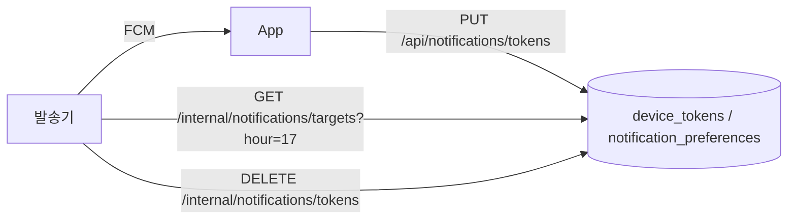

# 푸시 알림 토큰과 수신 설정 (notification 모듈)

notification 모듈은 푸시 알림에 쓰는 회원의 기기 토큰(FCM 등록 토큰)과 시각별 수신 설정을 소유합니다.
백엔드는 FCM을 호출하지 않습니다. 발송 시각 판단과 FCM 호출은 별도 발송기 서비스가 맡고, 백엔드는 내부 API로 발송 대상을 내주고 무효 토큰을 지웁니다.

## 애그리거트

| 애그리거트 | 범위 | 저장 내용 |
|---|---|---|
| `DeviceToken` | 토큰당 한 행 | 회원 ID, FCM 등록 토큰, 플랫폼(`IOS`·`ANDROID`), 마지막 확인 시각 |
| `NotificationPreference` | 회원·시각당 한 행 | 시각(Asia/Seoul 기준 0~23), 수신 여부 |

- 회원은 ID로만 참조하고 `users`에 FK만 둡니다. 다른 모듈의 엔티티를 연관으로 잡지 않습니다.
- 토큰은 기기마다 하나라 전체에서 유니크입니다. 같은 토큰이 다시 들어오면 행을 새로 만들지 않고 회원 ID와 마지막 확인 시각을 덮어씁니다. 같은 기기에서 다른 계정으로 로그인하면 토큰이 새 계정으로 옮겨 갑니다.
- 시각의 0~23 범위는 DB `CHECK` 제약과 도메인(`NotificationHour.validate`)이 함께 지킵니다.
- 지금 앱이 쓰는 시각은 8·11·17시이고 기본값은 8·11시 끔, 17시 켬입니다. 허용 시각과 기본값은 `domain/NotificationHour` 상수 한 곳에만 두고 DB 제약으로 묶지 않습니다. 임의 시각을 허용하게 되면 상수만 풉니다.
- 회원에게 설정 행이 없으면 조회는 빈 목록(`{hours: []}`)으로 응답하고 행을 만들지 않습니다. 기본 세 행은 토큰을 처음 등록할 때 만듭니다.
- 설정 변경은 시각 하나씩 합니다. 허용 시각(`NotificationHour.validateAllowed`)이 아니면 400이고, 회원·시각 행이 있으면 값만 바꾸고 없으면 새로 만듭니다. 목록 전체를 보고 판단하는 규칙이 없어 일급 컬렉션은 두지 않고 `NotificationPreference` 엔티티와 `NotificationHour` 상수만 둡니다.

## 앱 API (JWT 인증)

| 메서드·경로 | 동작 |
|---|---|
| `PUT /api/notifications/tokens` | 토큰 upsert. 회원에게 설정 행이 없으면 기본 세 행 생성. 204 |
| `DELETE /api/notifications/tokens/{token}` | 로그아웃 때 본인 토큰 삭제. 없는 토큰이어도 204 |
| `GET /api/notifications/preferences` | `{hours: [{hour, enabled}]}`. 시각 오름차순. 설정 행이 없으면 `{hours: []}` |
| `PUT /api/notifications/preferences/{hour}` | `{enabled}`로 한 시각의 수신 여부 저장(upsert). 204. 허용 시각(8·11·17)이 아니면 400 |

## 내부 API (발송기 전용)

| 메서드·경로 | 동작 |
|---|---|
| `GET /internal/notifications/targets?hour=17` | `[{userId, token, platform}]`. 토큰당 한 행, 회원 ID 오름차순·같은 회원 안에서는 토큰 등록 순. 대상이 없으면 `[]`. 시각이 0~23 밖이면 400 |
| `DELETE /internal/notifications/tokens` | `{tokens: [...]}`의 토큰을 회원과 무관하게 삭제. 없는 토큰이 섞여도 204 |

### 인증

- `/internal/**`는 `notification/adapter/security/InternalSecurityConfig`가 정의한 별도 시큐리티 필터 체인(`@Order(0)`, `securityMatcher("/internal/**")`)이 처리합니다. JWT 디코더와 앱 버전 게이트를 타지 않습니다.
- `InternalSecretAuthenticationFilter`가 요청 헤더 `X-Internal-Secret`을 설정값 `meongcoach.notification.internal-secret`(환경 변수 `NOTIFICATION_INTERNAL_SECRET`)과 `MessageDigest.isEqual`로 비교해 같을 때만 인증 주체를 세웁니다. 헤더가 없거나 값이 다르면 401 Problem Details(`UNAUTHORIZED`)입니다.
- 설정값에 기본값이 없어 미주입 시 기동에 실패합니다. 액세스 토큰으로는 내부 API를, 비밀 헤더로는 앱 API를 호출할 수 없습니다.

## 발송 대상 규칙

1. `notification_preferences`에서 `hour = ? AND enabled = true`인 행의 회원 ID를 모읍니다.
2. `user`의 `UserFinder.findActiveUserIds`로 상태가 `ACTIVE`인 회원만 남깁니다. 탈퇴 회원은 빠집니다.
3. 남은 회원의 `device_tokens`를 한 번에 조회해 토큰당 한 행으로 반환합니다. 회원 ID 오름차순, 같은 회원 안에서는 토큰 등록 순(`id` 오름차순)입니다. 토큰이 없는 회원은 응답에서 빠집니다.

설정 행이 없는 회원은 기본값이 켜져 있어도 대상이 아닙니다. 토큰 등록이 기본 행을 만들므로 토큰이 있는 회원에게는 행이 있습니다.

## 탈퇴 시 정리

`auth`의 `AuthenticationService.withdraw`가 `userRegister.withdraw` 전에 `NotificationRegister.deleteAllByUserId`를 호출해 회원의 토큰과 설정을 모두 지웁니다. 의존 방향은 `auth → notification` 한쪽뿐입니다.
