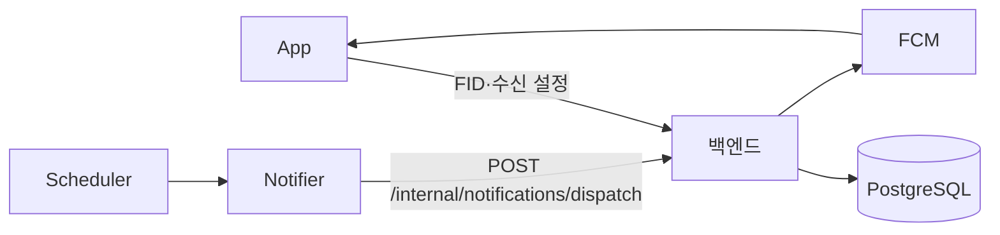

# 푸시 알림 FID와 수신 설정 (notification 모듈)

notification 모듈은 푸시 알림에 쓰는 회원의 기기 FID(Firebase Installation ID(FID))과 시각별 수신 설정을 소유합니다.
백엔드는 발송 대상 조회, FCM 발송과 무효 FID 삭제를 맡습니다. 외부 스케줄러가 띄운 notifier는 발송 API를 한 번 호출합니다.

## 애그리거트

| 애그리거트 | 범위 | 저장 내용 |
|---|---|---|
| `DeviceInstallation` | FID당 한 행 | 회원 ID, Firebase Installation ID(FID), 플랫폼(`IOS`·`ANDROID`), 마지막 확인 시각 |
| `NotificationPreference` | 회원·시각당 한 행 | 시각(Asia/Seoul 기준 0~23), 수신 여부 |

- 회원은 ID로만 참조하고 `users`에 FK만 둡니다. 다른 모듈의 엔티티를 연관으로 잡지 않습니다.
- FID는 기기마다 하나라 전체에서 유니크입니다. 같은 FID가 다시 들어오면 행을 새로 만들지 않고 회원 ID와 마지막 확인 시각을 덮어씁니다. 같은 기기에서 다른 계정으로 로그인하면 FID가 새 계정으로 옮겨 갑니다.
- 시각의 0~23 범위는 DB `CHECK` 제약과 도메인(`NotificationHour.validate`)이 함께 지킵니다.
- 지금 앱이 쓰는 시각은 8·11·17시이고 기본값은 8·11시 끔, 17시 켬입니다. 허용 시각과 기본값은 `domain/NotificationHour` 상수 한 곳에만 두고 DB 제약으로 묶지 않습니다. 임의 시각을 허용하게 되면 상수만 풉니다.
- 회원에게 설정 행이 없으면 조회는 빈 목록(`{hours: []}`)으로 응답하고 행을 만들지 않습니다. 기본 세 행은 FID를 처음 등록할 때 만듭니다.
- 설정 변경은 시각 하나씩 합니다. 허용 시각(`NotificationHour.validateAllowed`)이 아니면 400이고, 회원·시각 행이 있으면 값만 바꾸고 없으면 새로 만듭니다. 목록 전체를 보고 판단하는 규칙이 없어 일급 컬렉션은 두지 않고 `NotificationPreference` 엔티티와 `NotificationHour` 상수만 둡니다.

## 앱 API (JWT 인증)

| 메서드·경로 | 동작 |
|---|---|
| `PUT /api/notifications/installations` | FID upsert. 회원에게 설정 행이 없으면 기본 세 행 생성. 204 |
| `DELETE /api/notifications/installations` | 로그아웃 때 본인 FID 삭제. 본문 `{fid}`. FID를 URL에 두면 접근 로그에 남으므로 본문으로 받는다. 없는 FID가어도 204 |
| `GET /api/notifications/preferences` | `{hours: [{hour, enabled}]}`. 시각 오름차순. 설정 행이 없으면 `{hours: []}` |
| `PUT /api/notifications/preferences/{hour}` | `{enabled}`로 한 시각의 수신 여부 저장(upsert). 204. 허용 시각(8·11·17)이 아니면 400 |

## 내부 API (발송기 전용)

| 메서드·경로 | 동작 |
|---|---|
| `POST /internal/notifications/dispatch` | `{scheduledTime, hour}`로 발송. `{fids, duplicate}` 응답. 같은 예약 시각·hour의 재호출은 발송 없이 duplicate=true |

### 인증

- `/internal/**`는 `notification/adapter/security/InternalSecurityConfig`가 정의한 별도 시큐리티 필터 체인(`@Order(0)`, `securityMatcher("/internal/**")`)이 처리합니다. JWT 디코더와 앱 버전 게이트를 타지 않습니다.
- `InternalSecretAuthenticationFilter`가 요청 헤더 `X-Internal-Secret`을 설정값 `meongcoach.notification.internal-secret`(환경 변수 `NOTIFICATION_INTERNAL_SECRET`)과 `MessageDigest.isEqual`로 비교해 같을 때만 인증 주체를 세웁니다. 헤더가 없거나 값이 다르면 401 Problem Details(`UNAUTHORIZED`)입니다.
- 설정값에 기본값이 없어 미주입 시 기동에 실패합니다. 액세스 FID으로는 내부 API를, 비밀 헤더로는 앱 API를 호출할 수 없습니다.

## 발송 대상 규칙

1. `notification_preferences`에서 `hour = ? AND enabled = true`인 행의 회원 ID를 모읍니다.
2. `user`의 `UserFinder.findActiveUserIds`로 상태가 `ACTIVE`인 회원만 남깁니다. 탈퇴 회원은 빠집니다.
3. 남은 회원의 `device_installations`를 한 번에 조회해 FID당 한 행으로 반환합니다. 회원 ID 오름차순, 같은 회원 안에서는 FID 등록 순(`id` 오름차순)입니다. FID가 없는 회원은 응답에서 빠집니다.

설정 행이 없는 회원은 기본값이 켜져 있어도 대상이 아닙니다. FID 등록이 기본 행을 만들므로 FID가 있는 회원에게는 행이 있습니다.

## 탈퇴 시 정리

`auth`의 `AuthenticationService.withdraw`가 `userRegister.withdraw` 전에 `NotificationRegister.deleteAllByUserId`를 호출해 회원의 FID와 설정을 모두 지웁니다. 의존 방향은 `auth → notification` 한쪽뿐입니다.

## 발송 처리

기준 코드는 `NotificationDispatchService`와 `FirebaseNotificationSender`입니다.
`scheduledTime`은 ISO 8601 UTC 시각이고 `hour`는 서울 기준 0~23입니다. Scheduler가 원래 예약 시각을 넘기므로 기동 지연이나 재호출에도 같은 키를 씁니다.

`notification_dispatches`는 자동 생성하는 내부 `id`와 발송을 완료한 예약 식별자 `dispatch_key`, 완료 시각을 저장합니다.
`dispatch_key`에는 유니크 제약을 둡니다.
예약 키로 PostgreSQL 트랜잭션 advisory lock을 잡고 완료 이력을 확인합니다.
진행 중인 예약의 잠금을 얻지 못하거나 완료 이력이 있으면 `duplicate=true`로 응답합니다.
FCM 호출과 무효 FID 정리 뒤 완료 이력을 저장하고 커밋합니다.
발송 중에는 DB 트랜잭션과 연결을 유지합니다.

실패하면 등록 정리와 완료 이력을 롤백하며 같은 키로 다시 실행할 수 있습니다.
프로세스 중단 시 잠금은 DB 연결 종료와 함께 해제됩니다.
일부 FID에 전송된 뒤 실패하거나 완료 이력 커밋 전에 중단되면 재실행 시 중복 전달될 수 있습니다.

FID를 중복 제거하고 500개씩 발송합니다. `UNREGISTERED`만 FID 삭제 대상으로 삼습니다. `INVALID_ARGUMENT`는 메시지 오류일 수도 있으므로 삭제하지 않고 실패로 처리합니다.
무효 FID 외 실패가 있으면 FID 정리 뒤 첫 FCM 원인을 보존한 도메인 예외를 전파해 502를 반환합니다. 인증 실패는 401, 잘못된 hour는 400입니다.

메시지에는 시각별 훈련 안내, `data.hour`, `data.deepLink=meongcoach://training-curriculum`을 넣습니다.
Android는 HIGH 우선순위와 TTL 1시간을 사용합니다. APNs는 우선순위 10과 만료 1시간을 사용합니다.

`FIREBASE_SERVICE_ACCOUNT_JSON`으로 Firebase를 인증합니다. 값이 없으면 ADC를 사용하며 첫 발송 때 초기화합니다.
개발·운영 백엔드는 각 환경의 Firebase 프로젝트 키를 사용합니다. 키는 Terraform이 API 태스크 환경 변수에 주입합니다.

## FID 등록

앱은 FID 모드를 활성화한 Firebase Messaging에서 `register()`를 완료한 뒤 FID를 서버에 전송합니다.
등록·갱신 콜백에서도 현재 FID를 다시 동기화합니다. iOS는 APNs 등록과 알림 권한 확인을 먼저 완료합니다.
`PUT /api/notifications/installations`는 `{fid, platform}`, `DELETE /api/notifications/installations`는 `{fid}`를 받습니다.

`V37`은 기존 `device_tokens` 테이블과 등록 토큰을 삭제하고 FID 전용 `device_installations` 테이블을 만듭니다. 수신 설정은 유지합니다.
기존 앱은 FID 지원 앱으로 업데이트해야 새 발송 대상에 포함됩니다. 백엔드의 새 API와 마이그레이션을 먼저 배포하고 앱을 배포합니다.
