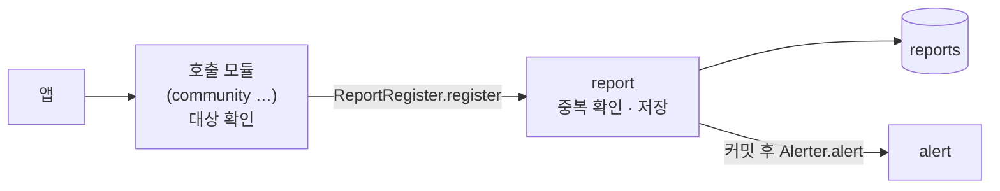

# 신고 (report 모듈)

report 모듈은 회원이 특정 대상에 사유를 붙여 남긴 신고를 저장하고 개발자 Slack 채널로 알립니다.
API는 두지 않습니다. 신고를 받는 모듈이 자기 경로에 API를 두고 `ReportRegister`를 호출합니다.
현재 호출하는 모듈은 community(게시글·댓글)입니다.



## 호출 방법

호출 모듈은 컨트롤러에서 `ReportRegisterRequest`를 본문으로 받아, 대상을 확인한 뒤 그대로 넘깁니다.
(살아있는 예시: `community/application/ContentReportModifyService`)

```java
Post post = postFinder.findPost(postId);
validateNotAuthor(userId, post.getUserId());

reportRegister.register(userId, ReportTargetType.COMMUNITY_POST, postId, request);
```

- **대상이 실제로 있는지는 호출 모듈이 확인합니다.** report는 대상을 종류와 ID로만 저장하고 다른 모듈을 조회하지 않습니다. 확인 없이 호출하면 없는 대상의 신고가 그대로 저장됩니다.
- **호출 모듈의 규칙은 호출 모듈에 둡니다.** 본인 글 신고 금지는 community 규칙입니다(`COMMUNITY_SELF_REPORT_NOT_ALLOWED`). 본인 것을 신고하는 것이 정상인 대상도 있으므로 report에 두지 않았습니다.
- **요청 본문은 `ReportRegisterRequest` 하나를 씁니다.** 호출 모듈이 본문 DTO를 따로 만들지 않아, 앱이 보내는 `reason`·`detail` 형식과 제약이 모든 신고 API에서 같습니다.
- 호출 모듈의 쓰기 트랜잭션 안에서 호출합니다. 대상 확인과 신고 저장이 한 트랜잭션에 묶입니다.

## 대상 종류와 사유 추가

- 대상 종류는 `domain/shared`의 `ReportTargetType`에, 사유는 `domain`의 `ReportReason`에 상수를 추가합니다. 컬럼은 문자열이고 CHECK 제약이 없어 마이그레이션이 필요 없습니다. 이름은 30자 이하로 짓습니다.
- 사유는 대상 종류와 무관하게 하나의 목록입니다. 어느 대상에나 모든 사유를 보낼 수 있습니다. 대상 종류마다 받을 사유를 제한해야 하면 그때 `ReportTargetType`이 허용 사유를 갖도록 바꿉니다.
- 사유 코드가 늘면 그 사유를 받는 모든 신고 API의 문서(`reportRequestFields`, `index.adoc`의 사유 표)를 함께 고칩니다.

## 중복 신고

- **한 회원은 같은 대상(종류 + ID)을 한 번만 신고합니다.** 다시 신고하면 409 `REPORT_ALREADY_REGISTERED`를 반환하고, 사유를 바꿔 보내도 처음 신고가 남습니다.
- 유니크 제약 `uk_reports_reporter_target`만으로는 동시에 들어온 두 요청 중 하나가 제약 위반(500)으로 끝납니다. 그래서 저장 전에 신고자 ID로 트랜잭션 advisory lock을 잡아 같은 회원의 신고를 차례로 처리합니다.
- advisory lock의 키는 회원 ID입니다. 쿠폰 사용과 AI 분석 횟수 변경도 같은 키를 쓰므로, 한 회원의 이 요청들은 서로 기다립니다.

## 알림

- 신고가 커밋되면 `ReportAlertListener`가 alert 모듈로 `신고 접수`를 보냅니다. 롤백되거나 거절된 신고는 알리지 않습니다.
- **알림에는 상세 내용(`detail`)을 싣지 않습니다.** 회원이 자유롭게 쓰는 글이라 개인정보가 들어갈 수 있습니다. 알림의 `reportId`로 `reports` 테이블에서 확인합니다.
- alert 모듈의 Slack webhook은 하나라서 신고 알림은 실습 인증 알림과 같은 채널로 갑니다. ([alert.md](alert.md#설정))
- 신고 처리 상태는 저장하지 않습니다. 관리 화면이 없어 운영자가 알림을 보고 대상을 직접 조치합니다.

## 문의와 합치지 않은 이유

신고는 대상이 반드시 있고, 사유 코드를 고르며, 회원에게 답하지 않는 한 방향 기록입니다. "결과가 잘못됐어요" 같은 AI 결과물 피드백도 같은 모양이라 대상 종류와 사유를 더해 이 모듈로 받을 수 있습니다.
문의는 대상이 없고 답변이 오가는 대화입니다. 대화·메시지·첨부·답변 알림은 [support 모듈](support.md)이 이미 갖고 있으므로, 문의를 백엔드로 옮길 때는 support에 둡니다.
한 테이블에 합치면 대상과 사유가 비어 있는 행이 생기고 중복 규칙이 종류마다 달라집니다.
