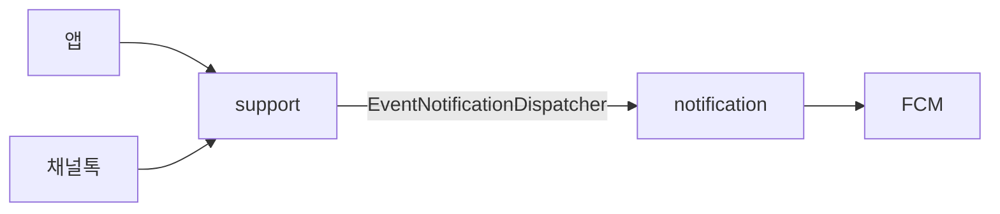
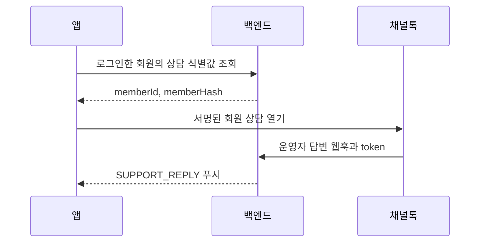

# 상담 (support 모듈)

support 모듈은 채널톡 상담 세션, 회원 서명, 웹훅 인증과 답변 선별을 소유합니다.
알림 기기·수신 설정·FCM 전송은 [notification 모듈](notification.md)이 소유합니다.



## 자체 실시간 상담 대화와 메시지

[ChatController](../src/main/java/com/daesabu/meongcoach/support/adapter/webapi/ChatController.java)는 본인 대화와 ADMIN 답변 API를 제공합니다.
대화 ID는 회원 ID와 같으며 `POST /api/support/conversations/me`가 처음 호출될 때 대화를 만듭니다.
회원은 본인 대화만, ADMIN은 모든 대화를 조회하고 답변합니다.

메시지 조회는 `after=-1`이면 최근 50건, `after>=0`이면 그 ID 이후 최대 50건, `before>0`이면 그 ID 이전 최대 50건을 오름차순으로 돌려줍니다.
`after>=0`과 `before>0`을 함께 쓰면 400입니다.
발송은 대화 행을 잠그고 같은 발신자의 `clientMessageId`가 이미 있으면 기존 메시지를 돌려주므로 재시도해도 중복 저장되지 않습니다.
ADMIN 상담 목록은 최근 활동 순이며 `before`는 대화 ID입니다.

## 자체 실시간 상담 연결

앱은 `/ws/support`에 `Authorization: Bearer {accessToken}` 헤더로 연결합니다.
React Native `WebSocket`은 세 번째 인자 `{ headers }`로 업그레이드 요청 헤더를 보낼 수 있습니다.
`/ws/support`는 일반 API와 같은 보안 필터 체인을 거치므로 토큰 검증과 회원 역할 확인이 업그레이드 전에 끝납니다.

[ChatWebSocketHandler](../src/main/java/com/daesabu/meongcoach/support/adapter/websocket/ChatWebSocketHandler.java)는 인증 주체에서 회원 ID, ADMIN 여부, 토큰 만료 시각을 읽습니다.
소켓은 본문 없는 신호만 보내며 `ping` 외의 클라이언트 메시지는 연결을 닫습니다.
토큰이 만료된 연결은 다음 송신 시점에 닫습니다.

## 회원 상담 식별

앱은 `GET /api/support/session`으로 로그인한 회원의 `memberId`와 `memberHash`를 받습니다.
회원 식별자는 모든 채널에서 회원 ID를 문자열로 바꾼 값입니다.
서버는 채널톡의 64자리 16진수 키를 바이트로 풀어 회원 식별자를 HMAC-SHA256으로 서명합니다.
회원 해시 키가 없으면 503 `SUPPORT_CHANNEL_TALK_UNAVAILABLE`을 반환하며 응답은 캐시하지 않습니다.



`CHANNEL_TALK_MEMBER_HASH_KEY`는 서버에서만 사용합니다.
개발·운영 배포는 GitHub Secrets `DEV_CHANNEL_TALK_MEMBER_HASH_KEY`, `PROD_CHANNEL_TALK_MEMBER_HASH_KEY`를 태스크 정의에 주입합니다.
웹훅 토큰은 `DEV_CHANNEL_TALK_WEBHOOK_TOKEN`, `PROD_CHANNEL_TALK_WEBHOOK_TOKEN`입니다.
백엔드와 비밀값을 먼저 배포하고 채널톡 회원 해시 검증을 켠 뒤 앱을 배포합니다.
기존 익명 상담 기록은 회원 상담으로 자동 합쳐지지 않습니다.
웹훅 토큰이 담긴 쿼리는 접근 로그에 남기지 않습니다.


## 개발·운영 채널 설정

개발 채널은 [멍코치-개발](https://e601x.channel.io), 운영 채널은 [멍코치](https://w637y.channel.io)입니다.
기존 운영 채널의 플러그인 키·회원 해시 키·웹훅 토큰을 개발 채널에 재사용하지 않습니다.

- EAS `development`·`preview`의 `EXPO_PUBLIC_CHANNEL_TALK_PLUGIN_KEY`: 개발 채널의 공개 플러그인 키입니다.
- EAS `production`의 `EXPO_PUBLIC_CHANNEL_TALK_PLUGIN_KEY`: 운영 채널의 공개 플러그인 키입니다.
- GitHub `DEV_CHANNEL_TALK_MEMBER_HASH_KEY`·`DEV_CHANNEL_TALK_WEBHOOK_TOKEN`: 개발 채널의 비밀값입니다.
- GitHub `PROD_CHANNEL_TALK_MEMBER_HASH_KEY`·`PROD_CHANNEL_TALK_WEBHOOK_TOKEN`: 운영 채널의 비밀값입니다.

개발 채널 웹훅은 개발 API 서버에만 연결하고 운영 채널 웹훅은 운영 API 서버에만 연결합니다.
각 채널에서 회원 해시 검증을 켭니다.
앱에 플러그인 키가 없으면 SDK를 로드하지 않고 문의 화면 오류를 표시합니다.
운영 키로 자동 대체하지 않습니다.

## 문의 답변 알림 (채널톡 웹훅)

개발·운영은 별도 채널톡 채널을 사용합니다. 개발·로컬·preview 앱은 개발 채널, production 앱은 운영 채널로 연결합니다.
앱의 문의 화면은 채널별 플러그인 키와 서명된 `memberId = {회원 ID}`로 웹 SDK를 실행합니다.
채널별 플러그인 키·회원 해시 키·웹훅 토큰으로 환경을 구분합니다.
각 채널의 데스크에 해당 환경의 웹훅만 등록합니다(스코프: 메시지). 주소는 `https://{API 호스트}/webhooks/channel-talk/support-replies?token={CHANNEL_TALK_WEBHOOK_TOKEN}`입니다.

```
채널톡 → POST /webhooks/channel-talk/support-replies?token=…
  → ChannelTalkAuthenticationFilter (웹훅 토큰 인증)
  → ChannelTalkWebhookController (요청 DTO 전달)
  → SupportReplyNotificationService → SupportReply.from (알림 대상 답변 생성)
  → EventNotificationDispatcher.dispatch(SUPPORT_REPLY, USERS, [회원 ID], 문구, 딥링크)
```

| 항목 | 규칙 |
|---|---|
| 발송 조건 | `event=push`, `type=message`, `entity.chatType=userChat`, `entity.personType=manager`, `refers.user.memberId`가 양의 정수인 회원 ID 문자열 |
| 제목 | `문의하신 내용에 답변이 왔어요` |
| 본문 | 메시지 본문(`plainText`)의 앞뒤 공백을 지운 앞 100자. 넘으면 `…`를 붙이고, 글이 없으면 `새 메시지가 도착했어요.` |
| 딥링크 | `meongcoach://support-chat` |

- 조건에 맞지 않는 이벤트(고객·봇 메시지, 내부 메모·알림 억제 메시지·마케팅, 팀 채팅, 유효하지 않은 회원 ID나 익명 고객)는 발송하지 않고 200을 반환합니다.
- 웹훅 요청 안에서 동기로 발송합니다. FCM이 실패하면 502를 반환하며, 중복을 막지 않으므로 채널톡이 같은 이벤트를 다시 보내면 다시 발송합니다.
- `application/provided/dto`의 `ChannelTalkWebhookRequest`는 웹훅 JSON을 받고 도메인 입력인 `SupportReplyCommand`로 변환합니다.
- `SupportReply.from`은 알림 대상 이벤트에만 답변 객체를 반환합니다. 생성된 `SupportReply`는 수신자 ID를 반드시 가지며 알림 본문을 만듭니다. `SupportReplyNotificationService`는 답변이 없으면 종료하고, 있으면 이벤트 알림 발송을 요청합니다.
- `ChannelTalkSecurityConfig`의 전용 무상태 체인이 `/webhooks/channel-talk/support-replies`를 처리합니다. `ChannelTalkAuthenticationFilter`가 쿼리 토큰을 `ChannelTalkProperties.matches`(`MessageDigest.isEqual`)로 검증합니다. 토큰이 없거나 다르면 본문 해석 전에 401 Problem Details를 반환합니다.
- 웹훅 인증에는 앱 JWT와 앱 버전 헤더를 사용하지 않습니다. 채널톡은 요청 헤더를 지정할 수 없어 쿼리 파라미터를 씁니다.

