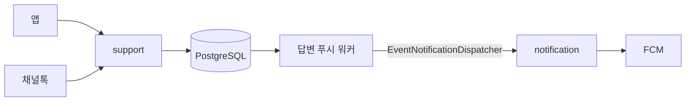
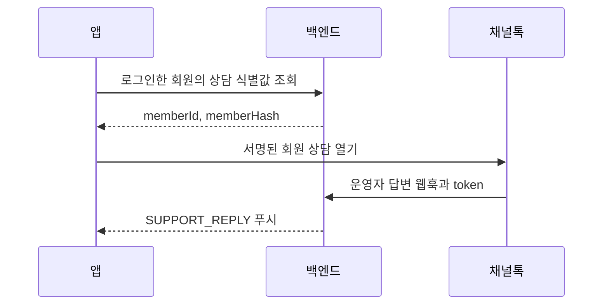

# 상담 (support 모듈)

support 모듈은 회원·ADMIN의 자체 실시간 상담, 답변 푸시 작업과 구버전 채널톡 연동을 소유합니다.
알림 기기·수신 설정·FCM 전송은 [notification 모듈](notification.md)이 소유합니다.



## 자체 실시간 상담

[ChatController](../src/main/java/com/daesabu/meongcoach/support/adapter/webapi/ChatController.java)는 본인 대화와 ADMIN 답변 API를 제공합니다.
메시지는 PostgreSQL에 저장합니다.
서버는 단일 인스턴스로 실행하며 메시지 전송과 조회에 REST API를 사용합니다.
채팅 화면은 마지막 조회 완료 후 2초 뒤 마지막 메시지 ID 이후를 다시 조회합니다.
화면을 벗어나거나 앱이 백그라운드로 가면 주기적 조회를 중단합니다.
화면 복귀 시 즉시 조회하며 한 번에 50건을 받으면 다음 페이지를 이어서 조회합니다.
메시지는 UUID로 중복 저장을 막고 요청마다 대화 접근 권한을 확인합니다.
상담원 목록도 화면이 활성화되어 있을 때 2초 간격으로 갱신합니다.


## 답변 푸시 작업과 재시도

[ChatModifyService](../src/main/java/com/daesabu/meongcoach/support/application/ChatModifyService.java)는 상담원 답변과 `support_push_jobs` 작업을 같은 트랜잭션에 저장합니다.
회원의 자기 메시지는 작업을 만들지 않습니다.
`message_id` 기본 키와 메시지 UUID 재사용으로 같은 답변의 작업을 중복 생성하지 않습니다.

[ChatPushWorker](../src/main/java/com/daesabu/meongcoach/support/adapter/integration/ChatPushWorker.java)는 인스턴스마다 전용 스레드 하나에서 작업을 한 건씩 처리합니다.
작업을 처리하면 다음 작업을 바로 조회합니다.
빈 큐와 DB 오류에서는 2초 기다리며 테스트 프로파일에서는 시작하지 않습니다.

[JdbcChatPushRepository](../src/main/java/com/daesabu/meongcoach/support/adapter/persistence/JdbcChatPushRepository.java)는 `FOR UPDATE SKIP LOCKED`로 작업을 선점합니다.
선점 트랜잭션을 커밋한 뒤 외부 알림을 호출하므로 FCM 응답을 기다리며 DB 잠금과 연결을 점유하지 않습니다.
선점마다 시도 횟수를 올리고 새 UUID 토큰과 10분 임대를 부여합니다.

완료와 실패 갱신은 현재 토큰과 유효한 임대를 함께 확인합니다.
프로세스가 종료되면 다른 워커가 임대 만료 후 작업을 회수합니다.
8번째 시도 중 종료된 작업은 임대 만료 후 `DEAD`로 바꾸며 선점 조회마다 최대 100건을 정리합니다.

작업 상태는 대기 `PENDING`, 발송 중 `PROCESSING`, 완료 `SENT`, 자동 재시도 종료 `DEAD`입니다.
실패 후 대기 시간은 30·60·120·240·480·960·1920초이며 최대 8회 시도합니다.
`attempts`, `available_at`, `lease_until`, `last_error`, `finished_at`으로 진행과 실패를 확인합니다.

매 시도마다 현재 활성 회원과 `SUPPORT_REPLY` 수신 설정을 확인합니다.
알림을 끄거나 유효한 기기가 없으면 발송 없이 `SENT`로 완료합니다.
FCM이 영구 무효로 판정한 기기는 기존 알림 모듈이 제거합니다.

일부 기기만 실패해도 작업을 완료하지 않고 `PARTIAL_DELIVERY`로 기록합니다.
재시도 대상은 회원의 현재 기기 전체이므로 먼저 성공한 기기는 중복 알림을 받을 수 있습니다.
이벤트 발송 결과의 내부 실패 건수만 확장하며 기존 HTTP 응답과 구버전 호출 동작은 유지합니다.

외부 발송 직후 DB 완료 확인 전에 서버가 종료되면 알림이 중복될 수 있습니다.
FCM 호출이 10분을 넘거나 DB 장애로 완료를 확인하지 못해 임대가 만료될 때도 다른 워커와 발송이 겹칠 수 있습니다.
외부 푸시의 정확히 한 번 전송은 보장하지 않습니다.

`SENT`와 `DEAD` 작업은 자동 삭제하지 않습니다.
영구 실패 원인과 기록을 확인할 수 있도록 보관하며 자동 재발송하지 않습니다.
재처리가 필요하면 원인을 해소한 뒤 운영자가 해당 `DEAD` 행의 `state='PENDING'`, `attempts=0`, `available_at=clock_timestamp()`, `finished_at=NULL`을 설정합니다.

## 구버전 회원 상담 식별

앱은 `GET /api/support/session`으로 로그인한 회원의 `memberId`와 `memberHash`를 받습니다.
회원 식별자는 모든 채널에서 회원 ID를 문자열로 바꾼 값입니다.
서버는 채널톡의 64자리 16진수 키를 바이트로 풀어 회원 식별자를 HMAC-SHA256으로 서명합니다.
회원 해시 키가 없으면 503 `SUPPORT_CHANNEL_TALK_UNAVAILABLE`을 반환하며 응답은 캐시하지 않습니다.



`CHANNEL_TALK_MEMBER_HASH_KEY`는 서버에서만 사용합니다.
개발·운영 배포는 GitHub Secrets `DEV_CHANNEL_TALK_MEMBER_HASH_KEY`, `PROD_CHANNEL_TALK_MEMBER_HASH_KEY`를 태스크 정의에 주입합니다.
웹훅 토큰은 `DEV_CHANNEL_TALK_WEBHOOK_TOKEN`, `PROD_CHANNEL_TALK_WEBHOOK_TOKEN`입니다.
백엔드와 비밀값을 먼저 배포하고 채널톡 회원 해시 검증을 켠 뒤 앱을 배포합니다.
기존 익명 상담 기록은 회원 상담으로 자동 합쳐지지 않습니다.
웹훅 토큰이 담긴 쿼리는 접근 로그에 남기지 않습니다.


## 구버전 개발·운영 채널 설정

개발 채널은 [멍코치-개발](https://e601x.channel.io), 운영 채널은 [멍코치](https://w637y.channel.io)입니다.
기존 운영 채널의 플러그인 키·회원 해시 키·웹훅 토큰을 개발 채널에 재사용하지 않습니다.

- EAS `development`·`preview`의 `EXPO_PUBLIC_CHANNEL_TALK_PLUGIN_KEY`: 개발 채널의 공개 플러그인 키입니다.
- EAS `production`의 `EXPO_PUBLIC_CHANNEL_TALK_PLUGIN_KEY`: 운영 채널의 공개 플러그인 키입니다.
- GitHub `DEV_CHANNEL_TALK_MEMBER_HASH_KEY`·`DEV_CHANNEL_TALK_WEBHOOK_TOKEN`: 개발 채널의 비밀값입니다.
- GitHub `PROD_CHANNEL_TALK_MEMBER_HASH_KEY`·`PROD_CHANNEL_TALK_WEBHOOK_TOKEN`: 운영 채널의 비밀값입니다.

개발 채널 웹훅은 개발 API 서버에만 연결하고 운영 채널 웹훅은 운영 API 서버에만 연결합니다.
각 채널에서 회원 해시 검증을 켭니다.
앱에 플러그인 키가 없으면 SDK를 로드하지 않고 문의 화면 오류를 표시합니다.
운영 키로 자동 대체하지 않습니다.

## 문의 답변 알림 (채널톡 웹훅)

개발·운영은 별도 채널톡 채널을 사용합니다. 개발·로컬·preview 앱은 개발 채널, production 앱은 운영 채널로 연결합니다.
구버전 앱의 문의 화면은 채널별 플러그인 키와 서명된 `memberId = {회원 ID}`로 웹 SDK를 실행합니다.
채널별 플러그인 키·회원 해시 키·웹훅 토큰으로 환경을 구분합니다.
각 채널의 데스크에 해당 환경의 웹훅만 등록합니다(스코프: 메시지). 주소는 `https://{API 호스트}/webhooks/channel-talk/support-replies?token={CHANNEL_TALK_WEBHOOK_TOKEN}`입니다.

```
채널톡 → POST /webhooks/channel-talk/support-replies?token=…
  → ChannelTalkAuthenticationFilter (웹훅 토큰 인증)
  → ChannelTalkWebhookController (요청 DTO 전달)
  → SupportReplyNotificationService → SupportReply.from (알림 대상 답변 생성)
  → EventNotificationDispatcher.dispatch(SUPPORT_REPLY, USERS, [회원 ID], 문구, 딥링크)
```

| 항목 | 규칙 |
|---|---|
| 발송 조건 | `event=push`, `type=message`, `entity.chatType=userChat`, `entity.personType=manager`, `refers.user.memberId`가 양의 정수인 회원 ID 문자열 |
| 제목 | `문의하신 내용에 답변이 왔어요` |
| 본문 | 메시지 본문(`plainText`)의 앞뒤 공백을 지운 앞 100자. 넘으면 `…`를 붙이고, 글이 없으면 `새 메시지가 도착했어요.` |
| 딥링크 | `meongcoach://support-chat` |

- 조건에 맞지 않는 이벤트(고객·봇 메시지, 내부 메모·알림 억제 메시지·마케팅, 팀 채팅, 유효하지 않은 회원 ID나 익명 고객)는 발송하지 않고 200을 반환합니다.
- 웹훅 요청 안에서 동기로 발송합니다. FCM이 실패하면 502를 반환하며, 중복을 막지 않으므로 채널톡이 같은 이벤트를 다시 보내면 다시 발송합니다.
- `application/provided/dto`의 `ChannelTalkWebhookRequest`는 웹훅 JSON을 받고 도메인 입력인 `SupportReplyCommand`로 변환합니다.
- `SupportReply.from`은 알림 대상 이벤트에만 답변 객체를 반환합니다. 생성된 `SupportReply`는 수신자 ID를 반드시 가지며 알림 본문을 만듭니다. `SupportReplyNotificationService`는 답변이 없으면 종료하고, 있으면 이벤트 알림 발송을 요청합니다.
- `ChannelTalkSecurityConfig`의 전용 무상태 체인이 `/webhooks/channel-talk/support-replies`를 처리합니다. `ChannelTalkAuthenticationFilter`가 쿼리 토큰을 `ChannelTalkProperties.matches`(`MessageDigest.isEqual`)로 검증합니다. 토큰이 없거나 다르면 본문 해석 전에 401 Problem Details를 반환합니다.
- 웹훅 인증에는 앱 JWT와 앱 버전 헤더를 사용하지 않습니다. 채널톡은 요청 헤더를 지정할 수 없어 쿼리 파라미터를 씁니다.

