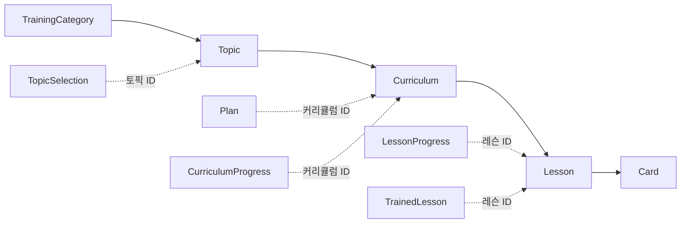

# 훈련 콘텐츠와 사용자 진행 (training 모듈)

training 모듈은 모든 사용자가 공유하는 훈련 콘텐츠와 반려견별 토픽 선택·레슨 진행·훈련 플랜·날짜별 훈련 기록을 소유합니다.
학습 진행은 레슨 단위로만 저장합니다.
커리큘럼과 토픽의 완료 상태는 저장하지 않고 조회할 때마다 현재 콘텐츠 구성으로 계산합니다.

## 애그리거트

| 애그리거트 | 범위 | 저장 내용 |
|---|---|---|
| 콘텐츠(`TrainingCategory`·`Topic`·`Curriculum`·`Lesson`·`Card`) | 전체 사용자 공용 | 구성, 정렬 순서 |
| `LessonProgress` | 사용자·반려견·레슨당 한 행 | 완료 횟수 |
| `TopicSelection` | 사용자·반려견당 한 행 | 마지막으로 선택한 토픽 |
| `Plan` | 사용자·반려견당 활성 한 행 | 커리큘럼 순서, 플랜 안에서 완료한 레슨 ID, 상태, 회고 |
| `CurriculumProgress` | 사용자·반려견·커리큘럼·날짜당 한 행 | 훈련한 날짜, 그날의 상태(`PENDING`·`SUCCEEDED`·`FAILED`) |
| `TrainedLesson` | 사용자·반려견·레슨·날짜·출처당 한 행 | 훈련한 날짜, 출처(`PLAN`·`LIBRARY`) |

- 사용자 기록은 콘텐츠와 반려견을 ID로만 참조하고 FK를 두지 않습니다.
- 레슨이 삭제돼도 그 레슨의 진행 기록은 남습니다.

## 반려견 지정

- 사용자 기록은 모두 반려견별입니다. 같은 사용자의 다른 반려견 기록은 진행, 완료 판단, 플랜 준비 어디에도 섞이지 않습니다.
- 컨트롤러가 받는 `dogId`는 선택입니다. 서비스가 `DogProfileFinder.findDogProfileOrSelected`로 반려견을 정하며, `dogId`가 없으면 선택된 반려견을 씁니다. 이 규칙은 dog 모듈 한 곳에만 있습니다.
- 지정한 반려견이 없거나 본인 소유가 아니면, 또는 선택된 반려견이 없으면 `DogNotFoundException`(404)입니다. 레슨·토픽 존재는 반려견보다 먼저 확인합니다.
- 다른 서비스가 이미 정한 반려견을 넘겨받는 조회(`TopicProgressFinder`, `TopicCompletionChecker`, `AiPlanPreparationFinder`)는 받은 `dogId`를 그대로 쓰고 다시 확인하지 않습니다.
- 반려견별 전환(V65) 이전의 기록은 사용자 단위였습니다. 기존 행은 선택된 반려견으로, 선택된 반려견이 없으면 가장 먼저 등록한 반려견으로 옮겼고, 반려견이 한 마리도 없는 사용자의 행은 지웠습니다.

## 완료 판단

- 레슨은 완료 횟수가 1 이상이면 완료입니다.
- 반복 완료는 완료 횟수만 늘리고 완료 레슨 수는 늘리지 않습니다.
- 커리큘럼 상태(`ProgressStatus`)는 현재 소속 레슨 수와 그중 완료한 레슨 수로 정합니다.

| 조건 | 처리 |
|---|---|
| 레슨이 없음 | 데이터 오류로 `IllegalStateException` 발생 |
| 레슨은 있지만 완료한 레슨이 없음 | `NOT_STARTED` |
| 일부 레슨만 완료 | `IN_PROGRESS` |
| 모든 레슨 완료 | `COMPLETED` |

- 토픽은 커리큘럼이 1개 이상이고 모든 커리큘럼이 `COMPLETED`이면 완료입니다.
- 새로 추가된 레슨은 미완료로 계산되므로 완료했던 커리큘럼도 `IN_PROGRESS`로 돌아갑니다.
- 삭제된 레슨의 진행 기록은 계산에서 빠집니다.
- 판단은 도메인이 합니다. `Curriculum.determineStatus`와 `Topic.isCompleted`가 반려견 한 마리의 레슨 진행 모음(`LessonProgresses`)을 받아 계산합니다.

## 조회

- 진행은 대상 레슨 ID 목록으로 한 번에 조회합니다. 커리큘럼이나 토픽마다 따로 조회하지 않습니다.
- 커리큘럼 목록은 반려견이 마지막으로 선택한 토픽을 기준으로 합니다.
- 선택이 없거나 선택한 토픽이 삭제됐으면 교육 순서상 첫 토픽을 씁니다.
- 교육 순서는 카테고리 순서 다음 토픽 순서입니다. 각 순서는 정렬 순서가 같으면 ID 오름차순입니다.
- 완료 토픽 목록은 전체 토픽의 레슨 진행을 한 번에 조회해 교육 순서대로 반환합니다.

## 레슨 완료

- 레슨 완료는 레슨 존재를 확인한 뒤 완료 횟수를 1 늘리고 갱신된 횟수를 반환합니다.
- 같은 반려견·레슨의 동시 완료는 낙관적 잠금으로 감지합니다. 먼저 커밋한 완료만 반영하고 나머지는 409(`TRAINING_LESSON_COMPLETION_CONFLICT`)로 응답합니다.
- 반복 완료의 갱신 유실은 `LessonProgress`의 `@Version`이, 동시 첫 완료의 중복 생성은 사용자·반려견·레슨 유니크 제약(`uk_lesson_progress_user_dog_lesson`)이 막습니다.
- 충돌 판단 단위는 반려견·레슨 진행 행입니다. 같은 커리큘럼이나 토픽의 다른 레슨 완료와는 충돌하지 않습니다.
- 예외가 하나 있습니다. 같은 반려견이 같은 커리큘럼을 그날 처음 훈련하는 완료 두 건이 겹치면, 그날의 `CurriculumProgress`를 둘 다 만들려다 한쪽이 유니크 제약에 걸려 같은 409가 됩니다. 그날 기록이 이미 있으면 충돌하지 않습니다.
- 레슨을 완료하면 같은 트랜잭션에서 [날짜별 훈련 기록](#날짜별-훈련-기록)을 남깁니다.

## 플랜

- 플랜은 진행을 `LessonProgress`와 따로 기록합니다. 플랜 안에서 완료한 레슨 ID(`plans.completed_lesson_ids`)만 플랜 진도로 세므로, 이미 배운 토픽으로 만든 복습 플랜도 진도가 처음부터 시작합니다.
- 플랜에서 레슨을 완료하면 같은 트랜잭션에서 플랜의 반려견의 일반 학습 완료 횟수도 1 늘립니다. 플랜의 반려견이 삭제됐으면 `DogNotFoundException`입니다. 플랜에서 이미 완료한 레슨을 다시 요청하면 둘 다 바꾸지 않습니다.
- 플랜에서 완료한 레슨은 출처를 `PLAN`으로 [날짜별 훈련 기록](#날짜별-훈련-기록)에 남깁니다. 이미 완료한 레슨의 재요청도 그날의 기록은 남깁니다. 재요청한 레슨이 삭제된 뒤면 기록 없이 204로 끝납니다.
- 플랜의 커리큘럼 상태도 `ProgressStatus`로 표현하지만, 완료 레슨 수는 플랜 기록 기준입니다. 일반 학습 화면과 플랜 화면의 상태가 다를 수 있습니다.
- 레슨 순서는 토픽별로 따로 봅니다. 각 토픽의 첫 미완료 레슨만 완료할 수 있고, 다른 토픽의 진행은 영향을 주지 않습니다.
- 활성 플랜은 사용자·반려견당 하나입니다. 새 플랜을 만들면 기존 활성 플랜은 `REPLACED`가 되고, 동시 생성은 부분 유니크 인덱스(`uk_plans_active_user_dog`)가 막아 409(`PLAN_CREATION_CONFLICT`)로 응답합니다.

## 날짜별 훈련 기록

훈련 달력은 `TrainedLesson`(그날 어떤 레슨을 했는지)과 `CurriculumProgress`(그날 그 커리큘럼의 결과)로 만듭니다.
둘 다 레슨을 완료할 때 `TrainedLessonRecordService`가 없을 때만 만듭니다.

- `LessonProgress`는 횟수만 누적하고 날짜가 없습니다. 그래서 달력에는 이 기록이 생긴 뒤의 훈련부터 쌓이고, 그 전의 완료는 소급하지 않습니다.
- 날짜는 서버가 완료를 처리한 시각의 Asia/Seoul 날짜입니다. 앱이 기기 현지 날짜로 날을 나누면 한국 밖에서는 하루 어긋날 수 있습니다.
- `TrainedLesson`은 같은 날 같은 출처로 여러 번 완료해도 한 행입니다(`uk_trained_lessons_user_dog_lesson_trained_date_source`). 같은 날 플랜과 라이브러리로 모두 하면 두 행입니다.
- 달력의 레슨 횟수(`completedCount`)는 `LessonProgress`의 완료 횟수가 아니라 그날까지 훈련한 날 수입니다. 출처와 무관하게 하루에 한 번만 세며 `TrainedLessons.countTrainedDaysUntil`이 계산합니다.
- 삭제된 레슨의 기록은 남지만 달력 조회에서 빠집니다. 삭제된 반려견의 기록도 남지만 조회와 결과 기록은 404입니다.
- 달력 조회와 결과 기록의 `dogId`는 필수입니다. 옛 계약이 없는 API라 선택된 반려견으로 대신하지 않습니다.

## 날짜별 커리큘럼 진행

- `CurriculumProgress`는 반려견이 커리큘럼을 훈련한 날마다 한 행을 남깁니다. 같은 날 여러 번 훈련해도 행은 하나이며, 유니크 제약(`uk_curriculum_progress_user_dog_curriculum_trained_date`)이 중복을 막습니다.
- 새 행은 `PENDING`으로 등록됩니다.
- 결과는 보호자가 훈련 결과 기록 API로 고릅니다. `CurriculumProgressModifyService`가 행을 배타 잠금으로 읽고, 지금과 같은 값이면 도메인 메서드를 부르지 않고 그대로 둡니다.
- 성공과 실패는 서로 바꿀 수 있습니다. `PENDING`으로 되돌리는 길은 없습니다.
- 이미 성공한 날에 `succeed()`를 호출하면 `IllegalStateException`이 납니다. 같은 값인지는 호출하는 쪽이 먼저 확인합니다.
- 레슨 진행으로 계산하는 커리큘럼 완료 상태(`ProgressStatus`)와는 별개의 기록입니다. 레슨을 모두 완료해도 이 기록은 생기지 않고, 이 기록이 있어도 커리큘럼 완료 상태는 바뀌지 않습니다.
