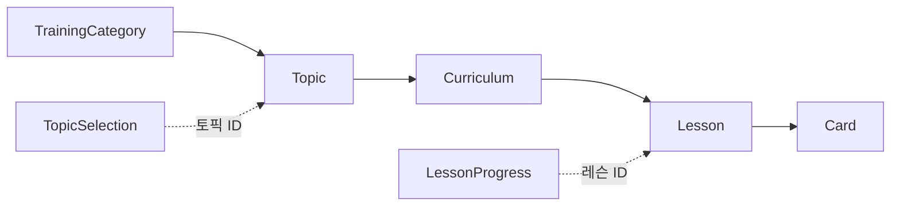

# 훈련 콘텐츠와 사용자 진행 (training 모듈)

training 모듈은 모든 사용자가 공유하는 훈련 콘텐츠와 사용자별 토픽 선택·레슨 진행을 소유합니다.
진행은 레슨 단위로만 저장합니다.
커리큘럼과 토픽의 완료 상태는 저장하지 않고 조회할 때마다 현재 콘텐츠 구성으로 계산합니다.

## 애그리거트

| 애그리거트 | 범위 | 저장 내용 |
|---|---|---|
| 콘텐츠(`TrainingCategory`·`Topic`·`Curriculum`·`Lesson`·`Card`) | 전체 사용자 공용 | 구성, 정렬 순서, 이용권 요구 조건 |
| `LessonProgress` | 사용자·레슨당 한 행 | 완료 횟수 |
| `TopicSelection` | 사용자당 한 행 | 마지막으로 선택한 토픽 |

- 사용자 기록은 콘텐츠를 ID로만 참조하고 FK를 두지 않습니다.
- 레슨이 삭제돼도 그 레슨의 진행 기록은 남습니다.

## 완료 판단

- 레슨은 완료 횟수가 1 이상이면 완료입니다.
- 반복 완료는 완료 횟수만 늘리고 완료 레슨 수는 늘리지 않습니다.
- 커리큘럼 상태(`ProgressStatus`)는 현재 소속 레슨 수와 그중 완료한 레슨 수로 정합니다.

| 조건 | 상태 |
|---|---|
| 레슨이 없거나 완료한 레슨이 없음 | `NOT_STARTED` |
| 일부 레슨만 완료 | `IN_PROGRESS` |
| 모든 레슨 완료 | `COMPLETED` |

- 토픽은 커리큘럼이 1개 이상이고 모든 커리큘럼이 `COMPLETED`이면 완료입니다.
- 새로 추가된 레슨은 미완료로 계산되므로 완료했던 커리큘럼도 `IN_PROGRESS`로 돌아갑니다.
- 삭제된 레슨의 진행 기록은 계산에서 빠집니다.
- 판단은 도메인이 합니다. `Curriculum.completion`과 `Topic.isCompleted`가 사용자의 레슨 진행 모음(`LessonProgresses`)을 받아 계산합니다.

## 조회

- 진행은 대상 레슨 ID 목록으로 한 번에 조회합니다. 커리큘럼이나 토픽마다 따로 조회하지 않습니다.
- 커리큘럼 목록은 사용자가 마지막으로 선택한 토픽을 기준으로 합니다.
- 선택이 없거나 선택한 토픽이 삭제됐으면 교육 순서상 첫 토픽을 씁니다.
- 교육 순서는 카테고리 순서 다음 토픽 순서입니다. 각 순서는 정렬 순서가 같으면 ID 오름차순입니다.
- 완료 토픽 목록은 전체 토픽의 레슨 진행을 한 번에 조회해 교육 순서대로 반환합니다.

## 레슨 완료

- 레슨 완료는 레슨 존재와 이용권을 확인한 뒤 완료 횟수를 1 늘리고 갱신된 횟수를 반환합니다.
- 이용권이 없으면 진행을 바꾸지 않고 `EntitlementRequiredException`을 던집니다.
- 같은 사용자·레슨의 동시 완료는 낙관적 잠금으로 감지합니다. 먼저 커밋한 완료만 반영하고 나머지는 409(`TRAINING_LESSON_COMPLETION_CONFLICT`)로 응답합니다.
- 반복 완료의 갱신 유실은 `LessonProgress`의 `@Version`이, 동시 첫 완료의 중복 생성은 사용자·레슨 유니크 제약이 막습니다.
- 충돌 판단 단위는 사용자·레슨 진행 행입니다. 같은 커리큘럼이나 토픽의 다른 레슨 완료와는 충돌하지 않습니다.
